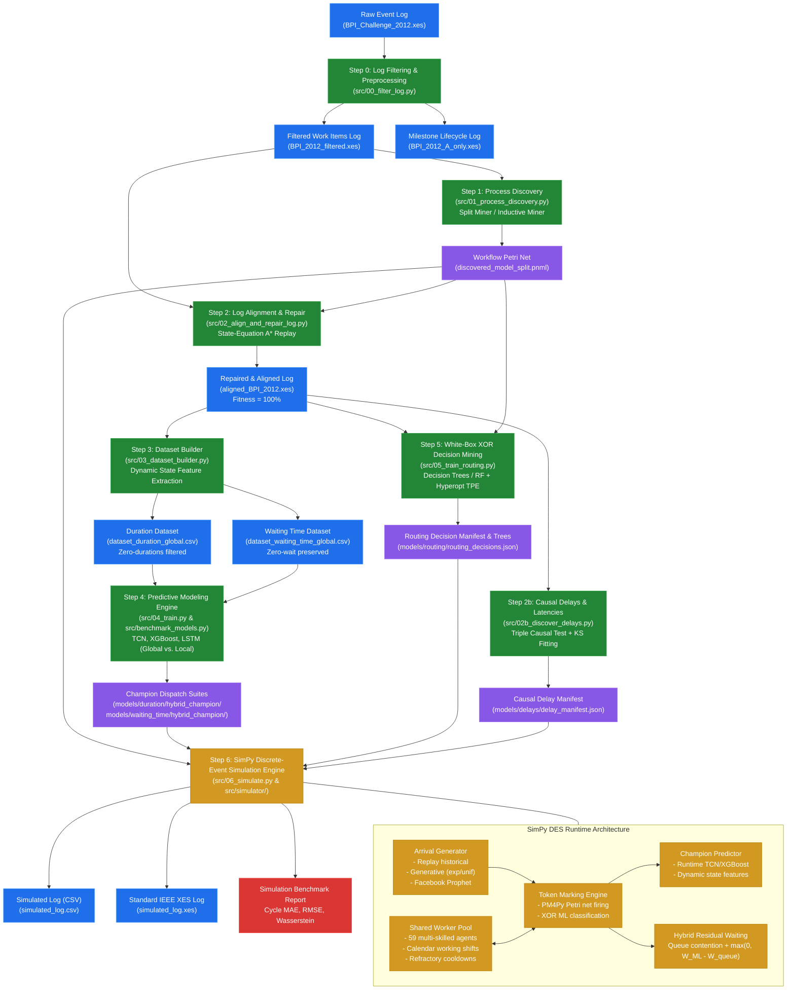

# RIMS+ End-to-End Pipeline Flowchart

This document provides a comprehensive flowchart and architectural breakdown of the **RIMS+** (Runtime Integration of Machine Learning & Simulation) end-to-end operational pipeline.

---

## 1. End-to-End Operational Flowchart

---

## 2. Stage Breakdown & Module Responsibilities

### Step 0: Log Preprocessing & Filtering ([`src/00_filter_log.py`](file:///home/antonio/fbk_rims/src/00_filter_log.py))
* **Goal**: Prepares high-quality event logs from raw data.
* **Actions**:
  * Translates Dutch activity names into English.
  * Separates human work items (`W_`) into `data/processed/BPI_2012_filtered.xes`.
  * Isolates business application lifecycle events (`A_`, `O_`) into `data/processed/BPI_2012_A_only.xes`.

---

### Step 1: Process Discovery ([`src/01_process_discovery.py`](file:///home/antonio/fbk_rims/src/01_process_discovery.py))
* **Goal**: Extracts a mathematically sound workflow Petri net.
* **Algorithms**:
  * **Split Miner** (default): High precision, discovers concurrency and loops.
  * **Inductive Miner**: Fallback option guaranteeing block-structured soundness.
* **Output**: `models/petri_nets/discovered_model_split.pnml`.

---

### Step 2: Log Alignment & Repair ([`src/02_align_and_repair_log.py`](file:///home/antonio/fbk_rims/src/02_align_and_repair_log.py))
* **Goal**: Resolves divergences between the empirical event log and the discovered process net.
* **Mechanism**:
  * Replays traces using PM4Py state-equation $A^*$ alignments.
  * Filters non-synchronous log moves and reconstructs conformant lifecycle executions.
  * Ensures 100% replay fitness so that simulated cases never encounter deadlocks.
* **Output**: `data/processed/aligned_BPI_2012.xes`.

---

### Step 2b: Causal Delay & Latency Discovery ([`src/02b_discover_delays.py`](file:///home/antonio/fbk_rims/src/02b_discover_delays.py))
* **Goal**: Isolates external uncoupled delays (customer transit / postal delays) and worker cooldowns.
* **Mechanism**:
  * **Triple Causal Test**: Resource Footprint Test $\to$ WIP/Congestion Correlation Test $\to$ Calendar Invariance (24/7 Clock) Test.
  * Fits parametric Kolmogorov-Smirnov continuous distributions (Lognormal, Gamma, Exponential).
* **Output**: `models/delays/delay_manifest.json`.

---

### Step 3: Feature Engineering & Tabular Datasets ([`src/03_dataset_builder.py`](file:///home/antonio/fbk_rims/src/03_dataset_builder.py))
* **Goal**: Constructs state-vector training tabular datasets without future lookahead bias.
* **Features Extracted**:
  * **Prefix**: Sequence of recent activities (up to window length 10).
  * **WIP / AC_WIP**: Total active cases in the process and active instances performing the specific task.
  * **Role Occupancy (`Role_*_OC`)**: Utilization ratio per organizational pool.
  * **Calendar**: Normalized time of day (`Daytime` $0.0 \dots 1.0$) and one-hot `Weekday_0..6`.
  * **Payloads**: Domain case attributes (e.g. `RequestedAmount`).
* **Task Isolation**:
  * **Duration**: Filters out instantaneous 0.0s automated events; calculates smoothed sample weights.
  * **Waiting Time**: Preserves 0.0s events (representing immediate queue pickups).

---

### Step 4: Multi-Architecture Predictive Modeling ([`src/04_train.py`](file:///home/antonio/fbk_rims/src/04_train.py) & [`src/benchmark_models.py`](file:///home/antonio/fbk_rims/src/benchmark_models.py))
* **Goal**: Evaluates multiple machine learning / deep learning architectures on strict case-level splits (70/10/20 train/val/test).
* **Engines Evaluated**:
  * **TCN** (PyTorch Temporal Convolutional Network with causal dilated convolutions).
  * **XGBoost** (Gradient boosted trees with `log1p` target transform).
  * **LSTM** (PyTorch stacked recurrent baseline).
* **Strategies**:
  * Global (pooled across all activities) vs. Local (specialized per activity).
  * **Hybrid Champion**: Automatically selects the winning architecture per activity (TCN for sequence-heavy, XGBoost for tabular volume).
* **Output**: `models/{task}/hybrid_champion/dispatch_config.json`.

---

### Step 5: White-Box XOR Decision Mining ([`src/05_train_routing.py`](file:///home/antonio/fbk_rims/src/05_train_routing.py))
* **Goal**: Determines path choices at Petri net XOR decision points dynamically.
* **Mechanism**:
  * Extracts decision contexts from aligned logs at places with out-degree $\ge 2$.
  * Trains interpretable white-box models (`DecisionTreeClassifier` or `RandomForestClassifier`) optimized via Hyperopt Bayesian TPE (`max_depth: 1..21`).
  * **Fallback**: If Macro F1 $< 0.60$, automatically falls back to empirical branching probabilities.
* **Output**: `models/routing/routing_decisions.json` and model binaries (`.joblib` / `.pkl`).

---

### Step 6: Discrete-Event Simulation Runtime ([`src/06_simulate.py`](file:///home/antonio/fbk_rims/src/06_simulate.py) & [`src/simulator/`](file:///home/antonio/fbk_rims/src/simulator/))
* **Goal**: Full closed-loop discrete-event process simulation with live ML runtime queries.
* **Key Components**:
  * **Arrival Generation**: Historical replay, parametric generative distributions, or **Facebook Prophet** hourly time-series forecasting.
  * **Resource Contention**: 59 distinct human agents respecting business shift calendars (08:00–20:00 Mon–Fri).
  * **Token Semantics**: PM4Py formal marking traversal, resolving XOR decisions via trained trees.
  * **Champion Inference**: Unified predictor querying winning TCN, XGBoost, or LSTM models.
  * **Hybrid Residual Waiting**: Workers acquired in SimPy queue contention ($W_{\text{queue}}$); simulator delays only uncoupled residual $\max(0, W_{\text{ML}} - W_{\text{queue}})$.
* **Evaluation & Outputs**:
  * `simulated_log.csv` and standard IEEE `simulated_log.xes`.
  * Cycle time MAE, RMSE, and 1D Wasserstein distance benchmark report.

